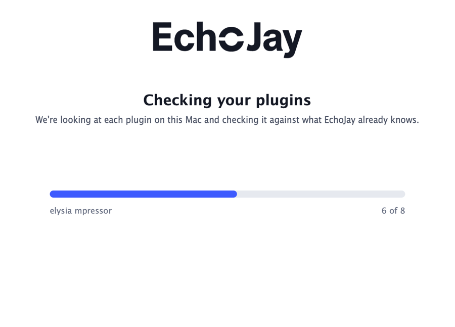
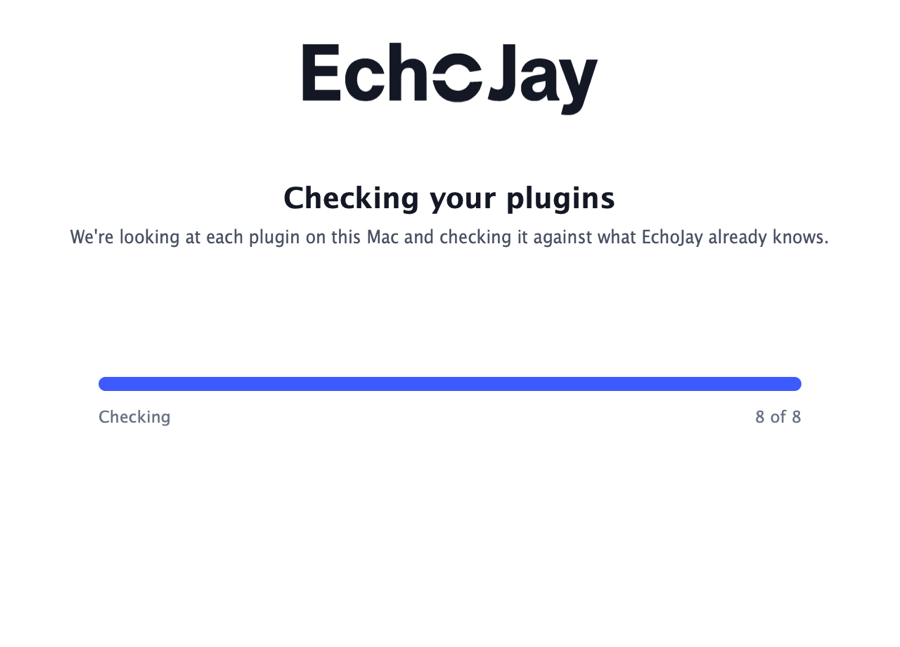
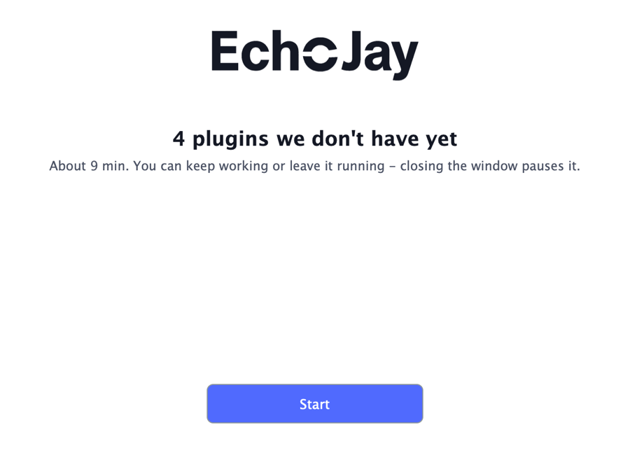
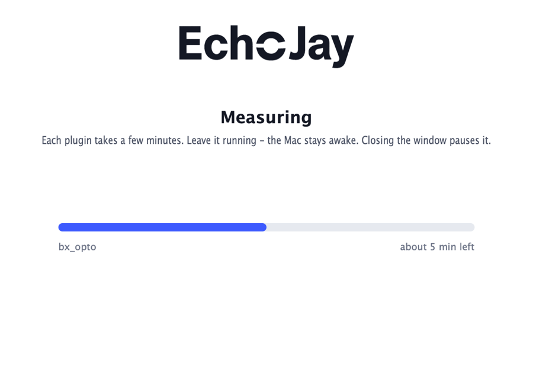
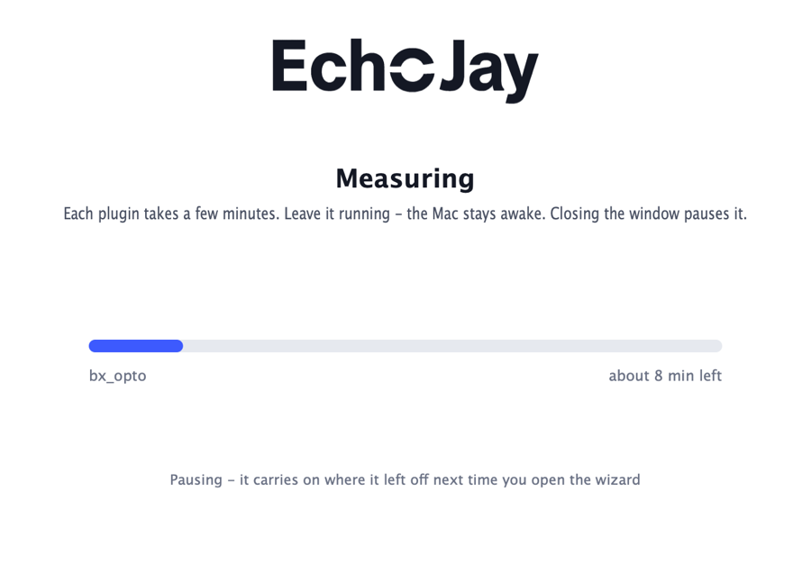
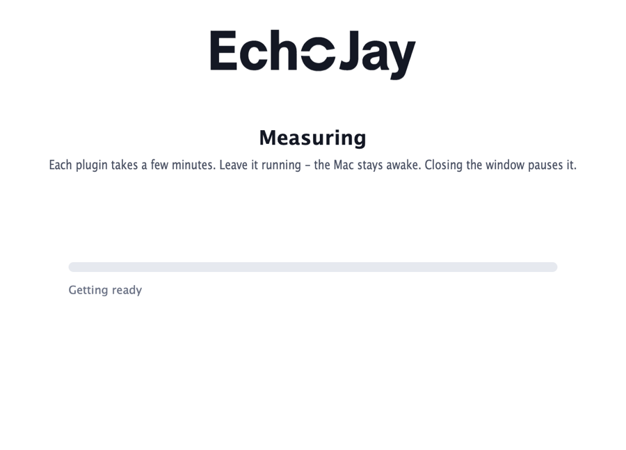
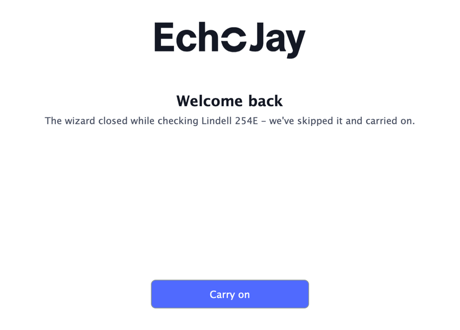
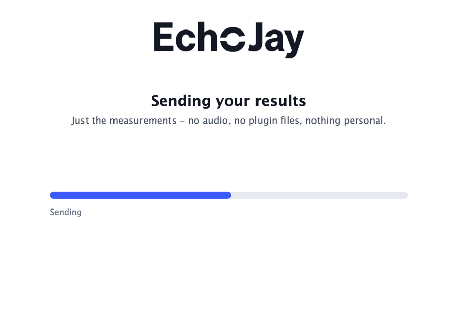
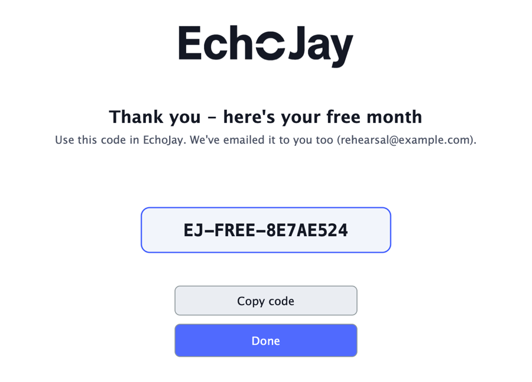
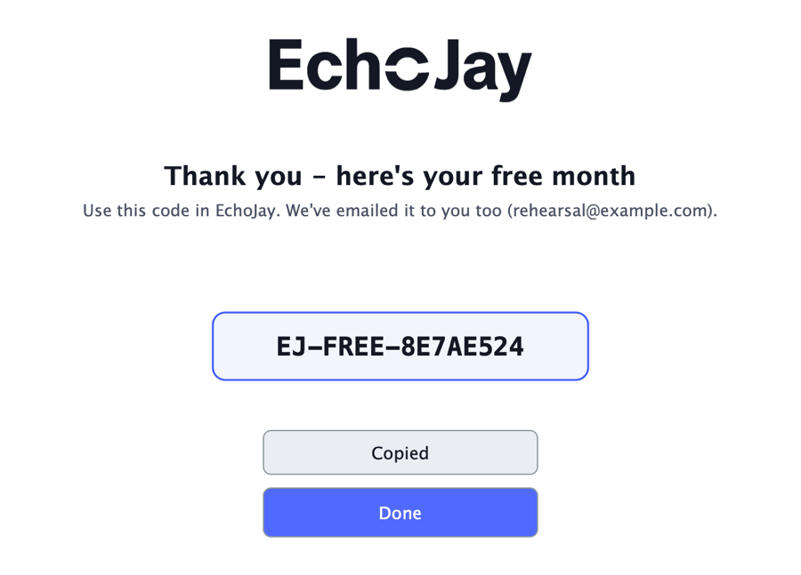

# EchoJay Wizard v1: end-to-end rehearsal, 11 Oct (feat/ejmap-wizard)

The app was assembled by `tools/ejmap/wizard_app/assemble.sh`. The engine and the Developer ID probe are inside the bundle; the app and the engine are signed ad hoc.

**Set-up**
- The 8 plugins from the 10 Oct empty-store set, with an EMPTY wizard store, the mock database folder as the stubbed lookup, `--jobs 2` and the real home folder.
- `--auto` (no hands) and `--snapshots` (each screen saved as a PNG of the window's content, at 2x, resized to 900 px here).
- The real `~/Library/ejmap`: 1123 maps before and after, and 0 files changed.

**The run** (`rehearsal.txt`, `app.log`)
1. **Launch 1.** Sign in (stub), then Scan: 8 plugins mapped and checked in 15 s. Scan done: "4 plugins we don't have yet - About 9 min". Start, then Measuring. 90 s in, **the close button** was pressed. The engine was paused (SIGINT, exit 130), keep-awake was released, and the app quit. No markers were left.
2. **Launch 2** opened straight on **Measuring**, carrying on. `pmset -g assertions` showed `PreventUserIdleSystemSleep named: "EchoJay Wizard is measuring your plugins"`. Once three plugins had landed and only Lindell 254E was in flight, the **forced crash**: the real `EchoJayProbe` process got SIGSEGV, and the app and the engine got SIGKILL. The 254E marker stayed. macOS wrote `EchoJayProbe-2026-10-11-135248.ips`.
3. **Launch 3** opened on **"Welcome back - The wizard closed while checking Lindell 254E - we've skipped it and carried on."** 254E is in `skip.json` with its redacted crash report. On Carry on, the engine skipped 254E ("never-retry list - not loaded"); everything else had landed. Then Upload (stub): genuine, 2 new profiles (mpressor, bx_opto), 2 confirmations (Maag EQ2, bx_townhouse) and 1 crash reported. Then Reward: `EJ-FREE-8E7AE524`, the code copied, and the stub's "email" in `promo_email.txt`.

**The bundle** (`contribution_manifest.json`) carries:
- `profiles` ×2 and `confirmations` ×2;
- `skipped`: Lindell 254E (crashed) and Lindell 6X-500 (not measurable: its EQ acceptance writes did not land, as in every 6X-500 run since 10 Oct);
- `crashed` ×1, with `crash_reports/Lindell 254E.crash.txt`.

It holds 0 personal hits (no `/Users/`, user or host).

## The screens

| | |
|---|---|
|  **1 Welcome + sign in** |  filled (stub account) |
|  **2 Scan**: each plugin's name, n of N |  scan at 100% |
|  **Scan done**: 4 we don't have, about 9 min |  **3 Measuring**: the plugin, time left |
|  closing = **pause** |  reopened: carries on |
|  **crash recovery** after the forced crash |  **4 Upload** |
|  **5 Reward** |  code copied |

Every PNG is in `screens/`. The name prefix is the launch time: 134336 is launch 1, 134530 launch 2, 135256 launch 3.

## Found while building and rehearsing (all fixed before the final run)

| what | fix |
|---|---|
| A dangling pointer: `readSkip(work).getArray()` pointed into a temporary var (the never-retry list read back empty) | Hold the var. Caught by the WZ-APP-1 pin, which failed |
| A use-after-free in the sign-in and upload stubs: `juce::var (o)` was made twice from one raw `DynamicObject`. The app crashed on Sign in in the first smoke run | One owner per object |
| The logo is white on transparent (made for the plugin's dark UI), so it was invisible on the white window | Drawn in ink through its alpha |
| The previous run's progress.json ("Done 100%") flashed on the next screen | Deleted before every engine start |
| macOS rewrites old crash reports' modification times, so a report picked by mtime could be days old | The time in the report's name decides. Pinned in WZ-APP-1, and the mutant goes red |
| The first rehearsal's "probe kill" hit the per-plugin `ejmap --cert` child: its command line contains the probe's path | The final run kills the process **named** EchoJayProbe. The recovery worked on both |

## Not exercised here

- A crash during Scan; the code path is the same marker.
- Two plugins in flight at the crash (both would be skipped: open decision in the spec).
- A real server.
- Developer ID signing and notarisation of the app.
